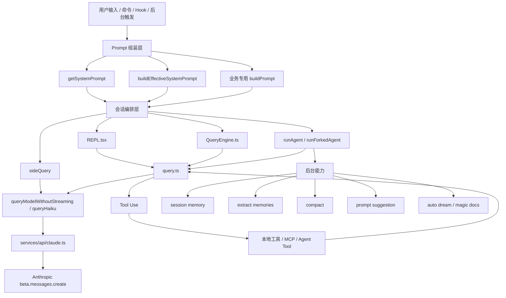
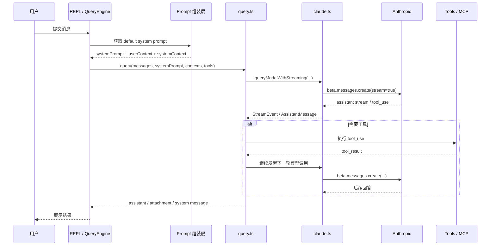
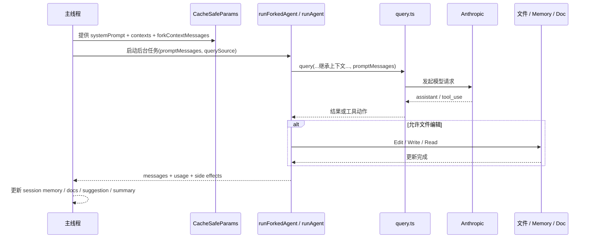

# cc-src 中 AI 的应用与 Prompt 研究

## 目标

本文梳理 `cc-src` 中 AI 的主要使用方式，重点回答两件事：

1. AI 在哪些场景被调用。
2. 每种场景调用时，prompt 是如何构造、由谁消费的。

本文不追求逐文件穷举，而是按调用模式和业务用途归类，覆盖主干链路与主要辅助链路。

## 一、统一调用栈

`cc-src` 里的 AI 调用大体可以分成三层：

### 1. 模型调用原语

- `services/api/claude.ts`
  - `queryModelWithStreaming(...)`：流式主调用。
  - `queryModelWithoutStreaming(...)`：非流式调用。
  - `queryHaiku(...)`：轻量二级模型调用封装，常用于命名、摘要、分类、解析等小任务。

这些函数最终都会走到 Anthropic SDK 的 `anthropic.beta.messages.create(...)`。

### 2. 会话级编排

- `query.ts`：主对话循环。负责把 `messages + systemPrompt + tools` 发给模型，解析 `tool_use`，执行工具，再把 `tool_result` 送回模型继续跑。
- `QueryEngine.ts`：SDK / headless 模式入口，负责收集上下文、拼接 prompt、调用 `query(...)`。
- `screens/REPL.tsx`：交互式 REPL 入口，做与 `QueryEngine` 类似的准备工作。

### 3. Prompt 组装层

- `constants/prompts.ts#getSystemPrompt(...)`：默认系统提示词来源。
- `utils/systemPrompt.ts#buildEffectiveSystemPrompt(...)`：把默认 prompt、agent prompt、自定义 prompt、append prompt 合并成最终系统提示词。
- `utils/queryContext.ts#fetchSystemPromptParts(...)`：收集 `systemPrompt/userContext/systemContext`。

## 图示：调用关系与时序

### 1. 调用关系图

### 2. 主代理时序图

### 3. Forked Agent / 后台能力时序图

## 二、Prompt 的总体分层

在 `cc-src` 里，prompt 不是单一字符串，而是多个来源叠加：

### 1. 默认系统 prompt

由 `constants/prompts.ts#getSystemPrompt(...)` 生成，主要包含：

- 会话行为指导 `session_guidance`
- memory 指导
- 环境信息 `env_info_simple`
- 语言偏好
- 输出风格
- MCP 指令
- scratchpad 指令
- 工具结果摘要要求
- 某些功能开关对应的附加段落

这部分定义了“Claude Code 主代理应该怎么工作”。

### 2. 有效系统 prompt

由 `buildEffectiveSystemPrompt(...)` 进一步决定优先级：

- override system prompt：完全覆盖
- coordinator prompt
- agent prompt
- custom system prompt
- default system prompt
- appendSystemPrompt：末尾追加

### 3. 用户上下文与系统上下文

- `userContext`：通过 `prependUserContext(...)` 作为消息前缀拼到消息流里。
- `systemContext`：通过 `appendSystemContext(...)` 拼进最终 `systemPrompt`。

### 4. 功能型子 prompt

很多功能不会复用主系统 prompt，而是用一小段专用 system prompt / user prompt 去完成单一任务，比如：

- 生成标题
- 写工具摘要
- 解析日期
- 审批分类
- 更新 session memory

## 三、主应用：编码代理主循环

### 用途

这是 `cc-src` 中最核心的 AI 用法：作为代码代理执行用户请求、决定是否调用工具、消费工具结果、继续推理，直到一轮完成。

### 主要入口

- 交互式：`screens/REPL.tsx`
- SDK / headless：`QueryEngine.ts`
- 执行循环：`query.ts`

### Prompt 构造

主循环使用的是“完整系统 prompt + 上下文 + 历史消息”：

1. `getSystemPrompt(...)` 生成默认系统 prompt。
2. `buildEffectiveSystemPrompt(...)` 注入 agent/custom/append prompt。
3. `appendSystemContext(...)` 把系统上下文并入 `fullSystemPrompt`。
4. `prependUserContext(...)` 把用户上下文并入消息数组。

### Prompt 用在什么地方

最终在 `query.ts` 中通过：

- `messages: prependUserContext(messagesForQuery, userContext)`
- `systemPrompt: fullSystemPrompt`

交给 `deps.callModel(...)`，而生产环境 `deps.callModel` 就是 `queryModelWithStreaming(...)`。

### 结论

主代理的 prompt 不是某一个静态模板，而是：

- 默认系统 prompt
- agent / custom prompt
- user/system context
- 消息历史
- 工具列表

共同组成的完整执行上下文。

## 四、对主会话的辅助 AI 能力

这些功能虽然不直接就是“主聊天回复”，但仍然是 `cc-src` 中重要的 AI 应用。

### 1. Compact / 对话压缩总结

#### 用途

在上下文过长时，把历史对话压缩成摘要，降低 token 占用。

#### 入口

- `services/compact/compact.ts`

#### Prompt

这里用的是一个非常短的系统 prompt：

- `You are a helpful AI assistant tasked with summarizing conversations.`

同时把“需要压缩的历史消息 + summaryRequest”发给模型。

#### 特点

- 这是专门的摘要任务，不走主代理的大系统 prompt。
- 工具一般只给极少量读工具，比如 `FileReadTool`，某些配置下会附带 `ToolSearchTool`。

### 2. Session Memory 更新

#### 用途

自动维护当前会话的结构化笔记文件，供长会话续航、压缩、恢复上下文使用。

#### 入口

- `services/SessionMemory/sessionMemory.ts`
- `services/SessionMemory/prompts.ts`

#### Prompt

核心 prompt 来自 `buildSessionMemoryUpdatePrompt(...)`，默认模板非常强约束，核心要求包括：

- 这不是用户会话内容，不要把“记笔记”过程写进 notes。
- 基于用户对话更新 session notes file。
- 只允许使用 `Edit` 工具更新 notes 文件，然后停止。
- 必须严格保留 markdown 模板结构、标题、斜体说明。
- 只更新每个 section 的正文。
- 写信息密度高、可操作的技术内容。
- 始终更新 `Current State`。

#### Prompt 用在什么地方

它不是直接调用 `queryModelWithoutStreaming`，而是通过 `runForkedAgent(...)` 启一个 forked agent，让这个 agent 带着该 prompt 去编辑 session memory 文件。

#### 特点

- 这是“让 AI 调工具写文件”的典型用法。
- system prompt 复用了主系统 prompt，以便共享 prompt cache。
- user prompt 则是 session memory 专用操作指令。

### 3. Extract Memories / 长期记忆提取

#### 用途

从最近若干条消息中抽取“值得长期保存”的记忆，更新 memory 目录。

#### 入口

- `services/extractMemories/extractMemories.ts`
- `services/extractMemories/prompts.ts`

#### Prompt

`buildExtractAutoOnlyPrompt(...)` 和 `buildExtractCombinedPrompt(...)` 会生成专门的 memory-extraction prompt，主要内容包括：

- 你现在是 memory extraction subagent。
- 只分析最近若干条消息。
- 不要去额外调查、grep 代码、跑 git 命令确认内容。
- 先并行读，后并行写，节省 turn budget。
- 如果用户明确要求记住某事，要立刻保存。
- 给出 memory 类型分类。
- 给出“什么不该保存”。
- 明确如何写 memory 文件与 `MEMORY.md` 索引。

#### Prompt 用在什么地方

与 session memory 类似，也是通过 `runForkedAgent(...)` 启动后台 memory subagent 来执行。

### 4. Agent Summary / 子代理进度摘要

#### 用途

对 coordinator mode 下的子代理做周期性进度总结，给 UI 展示。

#### 入口

- `services/AgentSummary/agentSummary.ts`

#### Prompt

`buildSummaryPrompt(previousSummary)` 要求模型：

- 用 3-5 个词描述最近动作
- 使用现在进行时
- 说出文件或函数名，不要说分支名
- 不使用工具
- 如果之前已有摘要，要说新内容

例如：

- `Reading runAgent.ts`
- `Fixing null check in validate.ts`

#### Prompt 用在什么地方

通过 `runForkedAgent(...)` 发给一个禁止用工具的 forked agent。

### 5. Away Summary / “你离开期间”摘要

#### 用途

用户回来时，用 1-3 句概括目前在做什么和下一步。

#### 入口

- `services/awaySummary.ts`

#### Prompt

`buildAwaySummaryPrompt(memory)` 会构造 user prompt，大意是：

- 用户离开后回来了。
- 精确写 1-3 句。
- 先说高层任务，不说实现细节。
- 然后说具体下一步。
- 不要写状态报告和 commit recap。

system prompt 为空，说明它完全依赖该 user prompt 和最近消息。

### 6. Tool Use Summary / 工具批次摘要

#### 用途

把一批刚执行完的工具调用压成移动端能显示的一行标签。

#### 入口

- `services/toolUseSummary/toolUseSummaryGenerator.ts`

#### Prompt

system prompt `TOOL_USE_SUMMARY_SYSTEM_PROMPT` 要求：

- 写一个短 summary label
- 像 git commit subject，不要像句子
- 过去式动词 + 最独特名词
- 大约 30 字符会被截断

user prompt 则是：

- 最近 assistant 文本里的用户意图
- 工具名、输入、输出摘要
- 最后要求输出 `Label:`

## 五、分类与决策型 AI

### 1. Auto Mode / YOLO Classifier

#### 用途

决定一个工具调用是自动放行，还是要拦下来让用户确认。

#### 入口

- `utils/permissions/yoloClassifier.ts`

#### Prompt 结构

这里的 prompt 不是代码里硬编码的一段短文，而是“模板拼装”：

1. `BASE_PROMPT`
   - 从 `yolo-classifier-prompts/auto_mode_system_prompt.txt` 加载。
2. `<permissions_template>`
   - 填入 external 或 anthropic 内部版本的 permissions template。
3. 用户自定义规则
   - `allow`
   - `soft_deny`
   - `environment`
4. transcript 和当前 action
   - 历史消息会被压成 classifier transcript。
   - 当前待执行动作会转成 `actionCompact` 拼在 user prompt 末尾。

#### Prompt 用在什么地方

`classifyYoloAction(...)` 中构造：

- `systemPrompt = await buildYoloSystemPrompt(context)`
- `userPrompt = transcript + actionCompact`

然后通过 `sideQuery(...)` 之类的路径请求模型。

#### 特点

- 这是一个“安全/权限决策 prompt”。
- prompt 本身依赖模板文件和用户配置，属于动态组装型系统 prompt。

### 2. Auto Mode 规则评审

#### 用途

分析用户自定义 auto mode 规则写得是否清晰、完整、有冲突。

#### 入口

- `cli/handlers/autoMode.ts`

#### Prompt

使用 `CRITIQUE_SYSTEM_PROMPT`，其职责是：

- 站在 auto mode classifier 规则审查者的角度
- 检查 clarity / completeness / conflicts / actionability
- 仅评论可改进之处

user message 会附上：

- 完整 classifier system prompt
- 用户自定义规则
- 被替换掉的默认规则

## 六、网页与内容处理类 AI

### 1. WebSearchTool

#### 用途

让模型驱动 `web_search` server tool 进行联网搜索。

#### 入口

- `tools/WebSearchTool/WebSearchTool.ts`

#### Prompt

system prompt 很短：

- `You are an assistant for performing a web search tool use`

user prompt 是：

- `Perform a web search for the query: <query>`

#### 特点

- 这是“模型只负责调用特定 server tool”的场景。
- 重点不在生成自然语言回答，而在触发标准化的 `web_search` 工具调用。

### 2. WebFetchTool 的内容提炼

#### 用途

对已抓取的网页 markdown 内容套用用户给的 prompt，得到摘要/抽取结果。

#### 入口

- `tools/WebFetchTool/utils.ts#applyPromptToMarkdown(...)`

#### Prompt

这里会先把网页内容转成 markdown，再通过 `makeSecondaryModelPrompt(...)` 生成二级 prompt。其输入包括：

- 截断后的 markdown 内容
- 用户传入的 prompt
- 域名是否预批准

最终调用 `queryHaiku(...)`，system prompt 为空，说明主要控制逻辑都放在 user prompt 里。

## 七、命名、生成、解析类轻量 AI

### 1. Session Title 生成

#### 用途

给会话生成 3-7 个词的标题。

#### 入口

- `utils/sessionTitle.ts`

#### Prompt

`SESSION_TITLE_PROMPT` 要求：

- 生成 sentence-case 标题
- 3-7 个词
- 用户在列表里能认出来
- 返回 JSON：`{"title": "..."}`

### 2. Session Name / Rename 生成

#### 用途

给会话生成 kebab-case 名称。

#### 入口

- `commands/rename/generateSessionName.ts`

#### Prompt

system prompt 要求：

- 生成 2-4 词的 kebab-case 名称
- 只用小写和连字符
- 返回 JSON：`{"name": "..."}`

### 3. Agent 生成

#### 用途

根据用户需求自动生成一个 agent 配置：identifier、whenToUse、systemPrompt。

#### 入口

- `components/agents/generateAgent.ts`

#### Prompt

system prompt `AGENT_CREATION_SYSTEM_PROMPT` 很长，核心是在要求模型扮演“AI agent architect”，完成：

- 提炼用户意图
- 设计专家 persona
- 写完整 agent system prompt
- 设计 identifier
- 设计 whenToUse 示例
- 在开启 auto-memory 时附加 memory instruction 段

user prompt 则是：

- `Create an agent configuration based on this request: "..."`
- 如有现存 identifier，则显式禁止重名
- 要求只返回 JSON

### 4. 自然语言日期解析

#### 用途

把诸如 “tomorrow at 3pm” 解析成 ISO 8601。

#### 入口

- `utils/mcp/dateTimeParser.ts`

#### Prompt

system prompt 要求：

- 你是 date/time parser
- 只能输出 ISO 8601
- 歧义时偏未来
- 解析失败就输出 `INVALID`

user prompt 会注入：

- 当前 UTC 时间
- 本地时区
- 星期几
- 用户原始输入
- 期望输出格式

### 5. Shell 前缀判定

#### 用途

在 shell 命令执行前，根据策略生成命令前缀或处理方式。

#### 入口

- `utils/shell/prefix.ts`

#### Prompt

system prompt 会告诉模型：

- 你的任务是处理 AI coding agent 想跑的 shell 命令
- 决定该命令应该使用何种 prefix

根据实验开关不同：

- 可能把 policy spec 放进 system prompt
- 也可能把 policy spec 放进 user prompt

user prompt 至少包含：

- `Command: <command>`

## 八、Hook 与扩展机制中的 AI

### 1. Prompt Hook

#### 用途

把某个 hook 配置成“用模型判断条件是否满足”。

#### 入口

- `utils/hooks/execPromptHook.ts`

#### Prompt

system prompt 明确要求响应必须是 JSON：

- `{"ok": true}`
- 或 `{"ok": false, "reason": "..."}`

user prompt 则来自用户配置的 `hook.prompt`，会把 `$ARGUMENTS` 替换为实际输入 JSON。

### 2. 通用 API Query Hook

#### 用途

为若干 post-sampling hook 提供统一的“构造消息 -> 调模型 -> 解析结果”框架。

#### 入口

- `utils/hooks/apiQueryHookHelper.ts`

#### Prompt

这里不内置固定 prompt，而是由具体 hook 配置决定：

- `buildMessages(context)` 决定 user messages
- `systemPrompt` 可覆盖，否则继承主上下文的 `context.systemPrompt`

它本质上是一个“AI 调用框架”，不是单一业务 prompt。

## 九、另一类重要用途：命令/Skill 生成主会话 Prompt

前面总结的是“直接调用模型”的地方。但 `cc-src` 里还有大量代码并不直接调用模型，而是把用户操作转成一段 prompt，再交给主代理执行。

这类代码同样值得纳入研究，因为它们决定了主代理“拿到什么指令”。

### 典型路径

- `utils/processUserInput/processSlashCommand.tsx`
  - 统一调用 `command.getPromptForCommand(args, context)`。
- `commands/*.ts`
- `skills/bundled/*.ts`

### 示例 1：`/review`

`commands/review.ts` 的 `LOCAL_REVIEW_PROMPT(args)` 会生成一段明确步骤式指令，要求主代理：

- 跑 `gh pr list` / `gh pr view` / `gh pr diff`
- 分析 PR
- 给出 correctness / conventions / performance / test coverage / security 等维度的 review

这里 AI 不是由 `/review` 直接调用，而是“主代理收到一段更强约束的用户 prompt”。

### 示例 2：`/batch` skill

`skills/bundled/batch.ts` 会构造一段很长的 orchestration prompt，要求主代理：

- 先研究和规划
- 拆成 5-30 个独立 work units
- 设计 e2e recipe
- 获批后并行拉起 worktree agents
- 跟踪 PR 状态

同样，这不是单独的小模型调用，而是“prompt 工程”直接作用于主代理。

## AI 调用清单表

说明：

- 这张表只列 `cc-src` 中“真正发起 AI 请求或 forked agent 请求”的文件。
- 像 `commands/review.ts`、`skills/bundled/batch.ts` 这类“只生成主会话 prompt”的文件，不放进此表。
- `services/api/claude.ts`、`utils/sideQuery.ts`、`utils/forkedAgent.ts` 这类底层封装会保留，因为它们定义了通用调用模式。

| 文件 | 调用形态 | querySource | 模型类型 | prompt 来源 | 输出用途 |
| --- | --- | --- | --- | --- | --- |
| `cc-src/screens/REPL.tsx` | `query()` 主循环 | `repl_main_thread` | 主模型 `mainLoopModel` | `getSystemPrompt` + `buildEffectiveSystemPrompt` + `user/system context` + 当前会话消息 | 交互式主会话编码代理 |
| `cc-src/QueryEngine.ts` | `query()` 主循环 | `sdk` | 用户指定模型或主模型 | `fetchSystemPromptParts` + custom/append system prompt + 会话消息 | SDK / headless 主会话 |
| `cc-src/tools/AgentTool/runAgent.ts` | `query()` 子代理循环 | `agent:*` / `agent:custom` / 调用方传入 | 继承或覆写后的 agent model | agent system prompt + 继承上下文 + `promptMessages` | 子代理、teammate、verification 等多轮执行 |
| `cc-src/utils/forkedAgent.ts` | `query()` forked agent | 调用方传入 | 继承父上下文模型 | `cacheSafeParams` 中的 system/user/system context + `promptMessages` | 通用后台 AI 执行框架 |
| `cc-src/services/compact/compact.ts` | `queryModelWithStreaming` / `runForkedAgent` | `compact` | 主模型 | 固定 summarizer system prompt + 历史消息 + `summaryRequest` | 长对话压缩与摘要 |
| `cc-src/services/SessionMemory/sessionMemory.ts` | `runForkedAgent` | `session_memory` | 继承主模型 | `buildSessionMemoryUpdatePrompt` + 主线程 cache-safe prompt 前缀 | 更新 session memory 文件 |
| `cc-src/services/extractMemories/extractMemories.ts` | `runForkedAgent` | `extract_memories` | 继承主模型 | `buildExtractAutoOnlyPrompt` / `buildExtractCombinedPrompt` | 提取长期记忆到 memory 目录 |
| `cc-src/services/AgentSummary/agentSummary.ts` | `runForkedAgent` | `agent_summary` | 继承父 agent 模型 | `buildSummaryPrompt(previousSummary)` | 生成子代理短进度摘要 |
| `cc-src/services/awaySummary.ts` | `queryModelWithoutStreaming` | `away_summary` | 小模型 `getSmallFastModel()` | `buildAwaySummaryPrompt(memory)` + 最近消息窗口 | 生成“离开期间”回顾卡片 |
| `cc-src/services/toolUseSummary/toolUseSummaryGenerator.ts` | `queryHaiku` | `tool_use_summary_generation` | 小模型 / Haiku | `TOOL_USE_SUMMARY_SYSTEM_PROMPT` + 工具输入输出摘要 | 生成工具批次一行标签 |
| `cc-src/services/autoDream/autoDream.ts` | `runForkedAgent` | `auto_dream` | 继承主模型 | `buildConsolidationPrompt(memoryRoot, transcriptDir, extra)` | 定期整理和巩固 memory |
| `cc-src/services/MagicDocs/magicDocs.ts` | `runAgent` | `magic_docs` | Magic Docs agent（`sonnet`） | `buildMagicDocsUpdatePrompt` + 文档现状 + document instructions | 自动更新 MAGIC DOC 文件 |
| `cc-src/services/PromptSuggestion/promptSuggestion.ts` | `runForkedAgent` | `prompt_suggestion` | 继承主模型 | 内置简短 suggestion prompt | 生成下一句建议提示 |
| `cc-src/services/PromptSuggestion/speculation.ts` | `runForkedAgent` | 推测性子任务专用 | 继承主模型 | `suggestionText` 或 cache-safe prompt | 在主线程旁路做 speculative execution |
| `cc-src/utils/sideQuestion.ts` | `runForkedAgent` | `side_question` | 继承主模型 | 包裹后的 side-question prompt，显式禁止工具 | 在主任务不中断时回答侧问题 |
| `cc-src/utils/hooks/execAgentHook.ts` | `query()` 多轮 agent hook | `hook_agent` | `hook.model` 或小模型 | 固定 stop-condition verifier system prompt + transcript path | 验证 stop hook 条件、输出结构化结果 |
| `cc-src/utils/permissions/yoloClassifier.ts` | `sideQuery` | `auto_mode` 相关 | classifier model / 主模型 | `BASE_PROMPT` + permissions template + 用户规则 + transcript + `actionCompact` | 自动审批/拦截工具调用 |
| `cc-src/cli/handlers/autoMode.ts` | `sideQuery` | `auto_mode_critique` | 指定模型或主模型 | `CRITIQUE_SYSTEM_PROMPT` + classifier full prompt + 用户规则 | 评审 auto mode 规则质量 |
| `cc-src/memdir/findRelevantMemories.ts` | `sideQuery` | `memdir_relevance` | 默认 Sonnet | `SELECT_MEMORIES_SYSTEM_PROMPT` + memory manifest + query | 选择最相关 memory 文件 |
| `cc-src/utils/permissions/permissionExplainer.ts` | `sideQuery` | `permission_explainer` | 主模型 | 固定 explainer system prompt + tool info + recent conversation | 给权限弹窗生成风险解释 |
| `cc-src/utils/agenticSessionSearch.ts` | `sideQuery` | `session_search` | 小模型 | `SESSION_SEARCH_SYSTEM_PROMPT` + session list + transcript excerpt + query | 在历史 session 中找相关会话 |
| `cc-src/utils/model/validateModel.ts` | `sideQuery` | `model_validation` | 用户输入模型 | 最小测试消息 `Hi`，几乎无 prompt | 验证模型名是否可用 |
| `cc-src/tools/WebSearchTool/WebSearchTool.ts` | `queryModelWithStreaming` | `web_search_tool` | 小模型或主模型 | 固定 web-search system prompt + 搜索 query | 驱动 `web_search` server tool |
| `cc-src/tools/WebFetchTool/utils.ts` | `queryHaiku` | `web_fetch_apply` | 小模型 / Haiku | `makeSecondaryModelPrompt(markdown, prompt, domainFlag)` | 对网页内容做摘要/抽取/改写 |
| `cc-src/utils/sessionTitle.ts` | `queryHaiku` | `generate_session_title` | 小模型 / Haiku | `SESSION_TITLE_PROMPT` + 对话文本 | 生成会话标题 |
| `cc-src/commands/rename/generateSessionName.ts` | `queryHaiku` | `rename_generate_name` | 小模型 / Haiku | kebab-case 命名 system prompt + 对话文本 | 生成会话名/分支风格名字 |
| `cc-src/components/agents/generateAgent.ts` | `queryModelWithoutStreaming` | `agent_creation` | 调用方指定模型 | `AGENT_CREATION_SYSTEM_PROMPT` + 可选 memory 指令 + 用户需求 | 生成 agent 配置 JSON |
| `cc-src/utils/mcp/dateTimeParser.ts` | `queryHaiku` | `mcp_datetime_parse` | 小模型 / Haiku | date parser system prompt + 当前时间/时区 + 用户输入 | 解析自然语言日期时间 |
| `cc-src/utils/shell/prefix.ts` | `queryHaiku` | 调用方传入 | 小模型 / Haiku | shell policy spec + `Command: ...` | 预判 shell 命令前缀/策略 |
| `cc-src/utils/hooks/execPromptHook.ts` | `queryModelWithoutStreaming` | `hook_prompt` | `hook.model` 或小模型 | 固定 JSON 契约 system prompt + 用户配置 `hook.prompt` | 用 LLM 执行 prompt 型 hook |
| `cc-src/utils/hooks/apiQueryHookHelper.ts` | `queryModelWithoutStreaming` | 调用方配置 | 调用方配置模型 | 调用方 `buildMessages(context)` + 可覆盖 `systemPrompt` | 通用 API query hook 执行器 |
| `cc-src/utils/hooks/skillImprovement.ts` | `queryModelWithoutStreaming` | `skill_improvement_apply` | 小模型 | skill rewrite system prompt + 当前 SKILL.md + 改进项 | 自动改写 skill 文件 |
| `cc-src/components/Feedback.tsx` | `queryHaiku` | `feedback` | 小模型 / Haiku | GitHub issue title 生成 system prompt + 描述 | 为反馈生成 issue 标题 |
| `cc-src/utils/teleport.tsx` | `queryHaiku` | `teleport_generate_title` | 小模型 / Haiku | `SESSION_TITLE_AND_BRANCH_PROMPT` | 生成远程会话标题与分支名 |
| `cc-src/utils/claudeInChrome/mcpServer.ts` | `sideQuery` | `chrome_mcp` | 调用方请求模型 | Chrome MCP 自带完整 `req.system` + `req.messages` | 替 Chrome MCP 发 Anthropic 请求 |

从这张表可以看出，`cc-src` 里的 AI 调用主要分成四种稳定形态：

1. 主会话 `query()`
2. forked agent / runAgent 背景轨道
3. `sideQuery` 单次非会话化判定
4. `queryHaiku` 小模型工具型调用

## 与 coderex 的对比

这里的 `cc-src` 和仓库中 `crates/` 下的 `coderex` 不是一回事：

- `cc-src` 是一套独立、成熟、功能丰富的 code agent 产品实现。
- `crates/` 下的 `coderex` 是参考 `cc-src` 重写/抽象出来的另一套实现，更偏内核与基础设施。

因此，二者都在“使用 AI”，但使用方式和抽象层次明显不同。

### 1. 总体定位对比

| 维度 | `cc-src` | `crates/` 中的 `coderex` |
| --- | --- | --- |
| 定位 | 产品层 agent 编排系统 | 内核化/重构中的 agent runtime |
| 代码风格 | TS/JS，功能模块密集 | Rust，核心抽象更集中 |
| AI 使用广度 | 很广，主会话外还有大量辅助 AI 功能 | 较收敛，围绕统一 engine 和 prompt compiler |
| Prompt 风格 | 多层拼装 + 大量 feature-specific prompt | 统一 compiler + 少量专用 prompt |
| 模型调用抽象 | `queryModelWithStreaming` / `queryHaiku` / `sideQuery` / `runForkedAgent` | `ApiClient::create_message` / `create_message_streaming` |

### 2. AI 使用位置对比

#### `cc-src`：AI 使用分布很广

`cc-src` 中，AI 不只是主对话代理，还被嵌入大量辅助能力：

- 主会话代理：`REPL.tsx`、`QueryEngine.ts`、`query.ts`
- 后台 agent：session memory、extract memories、compact、agent summary、prompt suggestion、auto dream、magic docs
- 单次决策/分类：auto mode classifier、permission explainer、session search、model validation
- 小模型工具任务：title 生成、rename、date parser、web fetch apply、feedback title、shell prefix
- 命令/skill prompt 生成：slash command、skills、agent 生成

也就是说，`cc-src` 的 AI 是“平台化渗透”的：

- 主会话在用 AI
- 辅助能力在用 AI
- 审批与解释在用 AI
- UI 附加体验也在用 AI

#### `coderex`：AI 使用主要集中在核心执行链

`crates/` 下的 `coderex` 目前更集中在这些位置：

- prompt 组装：`crates/coderex-core/src/prompt.rs`
- QueryEngine / turn state machine：`crates/coderex-core/src/engine.rs`
- API 调用：`crates/coderex-core/src/api_client.rs`
- CLI/REPL 接线：`crates/coderex-cli/src/repl.rs`
- 少量专门 prompt：`crates/coderex-memory/src/auto_dream.rs`
- 命令模式上下文注入：`crates/coderex-commands/src/misc_commands.rs`

换句话说，`coderex` 里的 AI 使用主要还是：

- 如何拼上下文
- 如何把消息发给模型
- 如何处理 streaming / tool call / compact / permission / elicitation

它还没有演化出 `cc-src` 那样密集的 feature-specific AI helper 生态。

### 3. Prompt 构建方式对比

#### `cc-src`：运行时多层拼装

`cc-src` 的 prompt 构建主要是运行时按功能动态拼起来的：

1. `getSystemPrompt(...)` 生成默认系统 prompt。
2. `buildEffectiveSystemPrompt(...)` 决定 agent/custom/append 的优先级。
3. `fetchSystemPromptParts(...)` 收集 `systemPrompt/userContext/systemContext`。
4. 很多功能再单独定义专用 prompt：
   - `buildSessionMemoryUpdatePrompt(...)`
   - `buildExtractAutoOnlyPrompt(...)`
   - `TOOL_USE_SUMMARY_SYSTEM_PROMPT`
   - `SESSION_TITLE_PROMPT`
   - `CRITIQUE_SYSTEM_PROMPT`
   - `SELECT_MEMORIES_SYSTEM_PROMPT`
   - 等等

因此 `cc-src` 的 prompt 体系是“通用系统 prompt + 大量专用任务 prompt”的组合。

#### `coderex`：PromptCompiler 统一编译

`coderex` 的 prompt 构建更像“编译器”模型，集中在 `crates/coderex-core/src/prompt.rs`：

- `PromptCompiler` 维护 `static_blocks` 和 `dynamic_blocks`
- 用 `BOUNDARY_MARKER` 切开静态/动态部分，服务 prompt cache
- `CLAUDE.md` 被包成 context message，而不是零散拼接
- `git branch` / `git status` 被统一收进 system context
- 编译输出是 `AssembledContext { system_prompt, context_messages, estimated_tokens }`

然后在 `crates/coderex-core/src/engine.rs` 中：

- 先把 `assembled.context_messages` 注入 turn messages
- 再放 `assembled.system_prompt`
- 再追加 session messages
- 再追加 `custom_system_prompt` / `append_system_prompt`

所以 `coderex` 的 prompt 方式更统一、更底层，强调：

- 块级编译
- cache 边界
- 上下文标准化装配

而不是像 `cc-src` 那样大量 feature-specific 入口各自定义 prompt。

### 4. 模型调用抽象对比

#### `cc-src`

`cc-src` 对模型调用做了很多按用途划分的抽象：

- `queryModelWithStreaming(...)`
- `queryModelWithoutStreaming(...)`
- `queryHaiku(...)`
- `sideQuery(...)`
- `runForkedAgent(...)`
- `runAgent(...)`

这反映的是产品层需求：

- 主会话要流式
- 小任务要轻量
- 判定类请求要旁路
- 背景 agent 要共享 cache-safe 上下文

#### `coderex`

`coderex` 的抽象更少、更接近协议层：

- `ApiClient::create_message(...)`
- `ApiClient::create_message_streaming(...)`

`engine.rs` 自己负责：

- 从 turn messages 提取 system messages
- 把非 system messages 序列化为 API messages
- 发 streaming / non-streaming 请求
- 装配 tool call delta

这说明 `coderex` 还处在“把基础通路抽稳”的阶段，而不是把每种 AI 用法包装成独立产品 API。

### 5. 命令与模式注入对比

`cc-src` 中，slash command / skill 往往直接生成一段 prompt 文本给主代理执行，比如 `/review`、`/batch`、`skillify`、`simplify`。

`coderex` 中，也有类似概念，但更简单：

- `crates/coderex-commands/src/registry.rs` 里的 `CommandResult::with_context(...)` 可以把额外上下文注入会话
- `crates/coderex-commands/src/misc_commands.rs` 里的 `/advisor`、`/bughunter` 本质上是给会话注入一段模式上下文

区别在于：

- `cc-src` 的命令/skill prompt 已经高度产品化，往往是完整 workflow prompt
- `coderex` 的命令 prompt 目前更像“切换模式”或“附加上下文”

### 6. Memory 相关 AI 使用对比

#### `cc-src`

memory 是强 AI 驱动的：

- session memory 通过 forked agent 更新 markdown 文件
- extract memories 用子代理写长期记忆
- auto dream 用后台 agent 做长期整理

#### `coderex`

memory 层更多是存储与抽象：

- `crates/coderex-memory/src/session_memory.rs` 目前是事实存储层，不是 LLM 提取器
- `crates/coderex-memory/src/auto_dream.rs` 有明确的 `generate_dream_prompt(...)`，说明这里保留了一小块 AI 驱动的 summarization 能力

也就是说：

- `cc-src`：memory 是 AI workflow 的一部分
- `coderex`：memory 目前更多是 data layer，只有少量 AI prompt 接口

### 7. 一个更准确的总结

如果把两者放在一起看：

- `cc-src` 更像“完整的 AI 产品层”
- `coderex` 更像“重写中的 AI 内核层”

二者关系不是简单的“功能多少”差异，而是抽象层不同：

- `cc-src` 关注“AI 能为产品做什么”
- `coderex` 关注“如何把 agent runtime、prompt compiler、API client、tool loop 抽成稳定内核”

因此，比较二者使用 AI 的方式时，最关键的不是逐项功能一一对应，而是下面这组差异：

| 对比点 | `cc-src` | `coderex` |
| --- | --- | --- |
| 主目标 | 完整产品能力 | 可复用核心引擎 |
| AI 用途 | 主会话 + 辅助功能 + 分类 + UI 增强 | 主会话执行链 + 少量 memory/模式 prompt |
| Prompt 组织 | 多模块拼装 + 大量专用 prompt | `PromptCompiler` 块式编译 + 少量专用 prompt |
| 调用抽象 | 按用途细分 | 按协议/内核抽象 |
| 命令系统 | 命令直接塑造 agent 行为 | 命令更多是注入额外 context |

### 8. 对当前文档的含义

因此，当前这份文档更准确的标题应该理解为：

- `cc-src 中 AI 的应用与 Prompt 研究`

而不是：

- `整个 coderex 仓库中的 AI 研究`

如果后续要扩成全仓版本，建议拆成两篇或两个大章节：

1. `cc-src`：产品层 AI 编排
2. `crates/coderex-*`：Rust 核心引擎中的 AI 执行链与 prompt compiler

## 十、结论

`cc-src` 中 AI 的使用不是单点，而是一个多层系统：

1. **主代理执行层**
   - 主系统 prompt + 上下文 + 历史消息 + 工具定义
   - 负责编码、推理、调工具、继续执行

2. **后台代理层**
   - compact
   - session memory
   - extract memories
   - agent summary
   - away summary
   - tool summary

3. **决策/分类层**
   - auto mode classifier
   - 规则 critique

4. **轻量任务层**
   - title / rename
   - date parsing
   - web content apply
   - web search tool-driving
   - shell prefix policy
   - hook evaluation

5. **prompt 生成层**
   - slash commands
   - skills
   - agents

如果只看“模型 API 是在哪调用的”，会漏掉一半设计重点。`cc-src` 的真实结构更像：

- 少数通用调用原语
- 大量业务 prompt 生成器
- 若干 forked-agent / helper-agent 工作流

共同组成一个可扩展的 AI 编排系统。

## 附：建议的后续阅读顺序

如果要继续深入，建议按下面顺序读代码：

1. `cc-src/constants/prompts.ts`
2. `cc-src/utils/systemPrompt.ts`
3. `cc-src/QueryEngine.ts`
4. `cc-src/query.ts`
5. `cc-src/services/api/claude.ts`
6. `cc-src/services/SessionMemory/*`
7. `cc-src/services/extractMemories/*`
8. `cc-src/utils/permissions/yoloClassifier.ts`
9. `cc-src/commands/*` 与 `cc-src/skills/bundled/*`